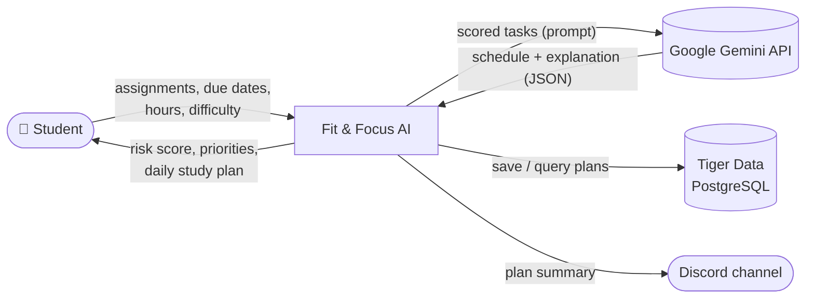
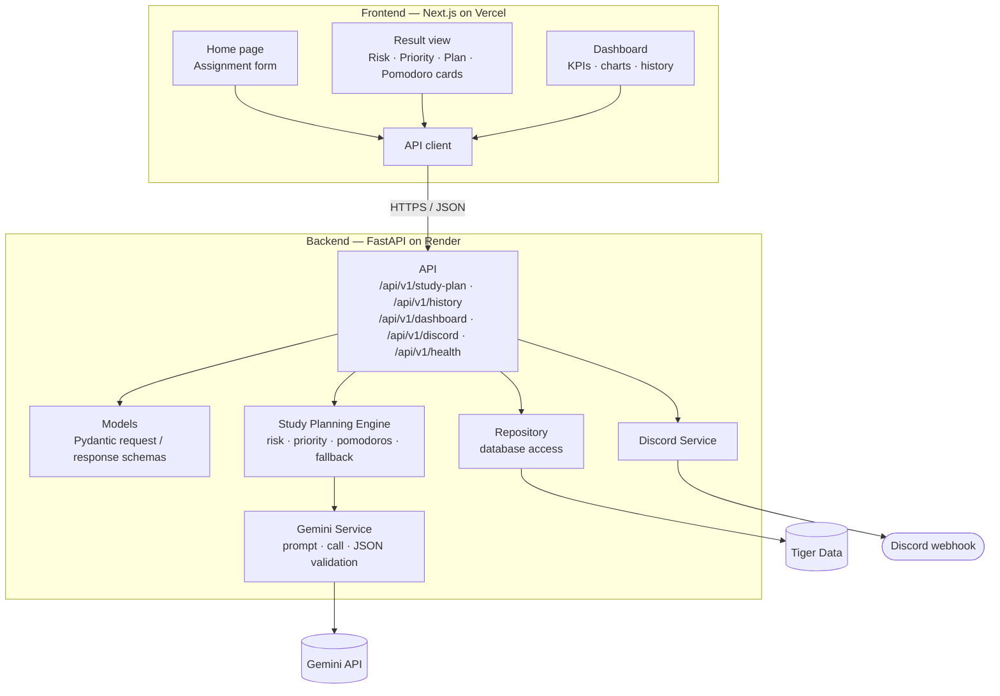
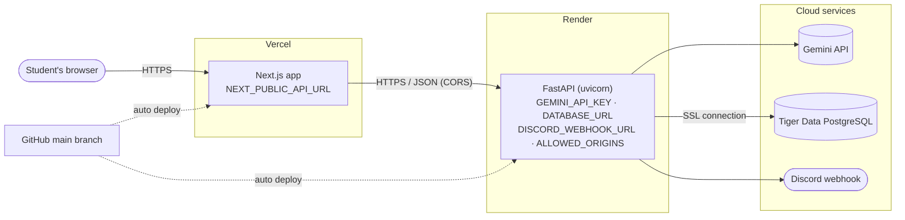

# System Architecture — Fit & Focus AI

| | |
|---|---|
| **Sprint** | Sprint 1 - Solution Design (1.1) |
| **Related** | [API Design](api-design.md) · [Use Cases](use-cases.md) · [Data Flow](data-flow.md) · [Sequence Diagrams](sequence-diagrams.md) · [Wireframes](wireframes.md) · [Architecture Review](architecture-review.md) |

> **Goal:** a new developer can understand how the system works without reading any code.

**Core workflow**

```text
Student → Assignment Input → Risk Analysis → AI Planning → Saved Plan → Dashboard → Notifications
```

---

## 1. Layers

| Layer | Component | Responsibility |
|-------|-----------|----------------|
| Presentation | Next.js frontend (TypeScript, Tailwind) | Assignment form, result cards, dashboard, history |
| API | FastAPI backend (Python) | Validation, business logic, orchestration |
| Planning | Study Planning Engine (inside FastAPI) | Risk score, priority, Pomodoro count, fallback schedule |
| AI | Google Gemini API | Daily schedule, risk explanation, study tips |
| Data | Tiger Data (PostgreSQL) | Plans, tasks, notification log |
| Notification | Discord webhook | Plan summary messages |
| Hosting | Vercel (frontend), Render (backend) | Deployment |

---

## 2. System Context Diagram

Shows the system as one box and everything outside it.



---

## 3. Component Diagram



| Component | Folder (planned) | Responsibility |
|-----------|------------------|----------------|
| API | `backend/api/` | HTTP endpoints under `/api/v1`, status codes |
| Schemas | `backend/schemas/` | Request and response schemas, input validation |
| Study Planning Engine | `backend/services/planner.py` | Deterministic risk, priority, Pomodoro and fallback schedule |
| Gemini Service | `backend/services/gemini.py` | Build prompt, call Gemini, validate JSON |
| Repository | `backend/services/repository.py` | Save and query plans and tasks |
| Discord Service | `backend/services/discord.py` | Format and send summaries |

---

## 4. Key Design Answers

### Frontend

| Question | Answer |
|----------|--------|
| What does the student enter? | Per assignment: **course**, **title**, **type** (assignment / exam), **due date**, **estimated hours**, **difficulty (1–5)**. Up to 20 items. |
| How are results shown? | Four cards: **Risk** (score 0–100 + level), **Priority** (ranked task list), **Study Plan** (day by day), **Pomodoro** (sessions per task). Plus a risk explanation and tips. |

### Backend — how risk is calculated

Risk is calculated by the backend with a fixed formula, **not by Gemini**. The same input always gives the same score, so it can be unit tested.

For each task (`today` = date of the request):

| Factor | Weight | Formula (0 – 1) |
|--------|--------|-----------------|
| Urgency | 40% | `days_left = due_date − today`; `1` if `days_left ≤ 1`, else `max(0, 1 − (days_left − 1) / 13)` (0 at 14+ days) |
| Workload | 30% | `min( (estimated_hours / max(days_left, 1)) / 4 , 1 )` (4+ hours/day needed = maximum) |
| Difficulty | 20% | `(difficulty − 1) / 4` |
| Overlap | 10% | `min(other_tasks_due_within_2_days / 3, 1)` |

```text
risk_score = round(100 × (0.4·urgency + 0.3·workload + 0.2·difficulty + 0.1·overlap))
```

| Score | Risk level |
|-------|------------|
| 0 – 39 | Low |
| 40 – 69 | Medium |
| 70 – 100 | High |

**Overall plan risk** = highest task score, shown on the Risk card.

> Example: Programming Lab due in 2 days, 6 hours, difficulty 4, one other task due nearby → urgency 0.92, workload 0.75, difficulty 0.75, overlap 0.33 → **78 (High)**.

### Backend — how priority is determined

| Rule | Result |
|------|--------|
| Priority level | Same as risk level: High / Medium / Low |
| Order | Sort by `risk_score` (highest first), then `due_date` (earliest first) |

### Backend — Pomodoros

| Rule | Value |
|------|-------|
| One Pomodoro | 25 min focus + 5 min break |
| Count per task | `ceil(estimated_hours × 60 / 25)` |
| Days available | From today to the day **before** the due date (due today → today only) |
| Daily limit | Maximum **8** Pomodoros per day |
| Overload | If tasks don't fit, add a warning and raise it in the risk explanation |

### AI

| Question | Answer |
|----------|--------|
| What is sent to Gemini? | Today's date, the scored tasks (title, course, type, due date, hours, difficulty, risk score, priority, Pomodoro count) and the rules (daily limit, finish before due date). No personal data. |
| What does Gemini do? | Arranges Pomodoros into a **daily schedule**, writes a plain-language **risk explanation** and 3–5 **study tips**. |
| What does Gemini **not** do? | Change risk scores, priorities or Pomodoro counts. |
| Expected JSON | See below. The backend validates it before use. |

```json
{
  "daily_schedule": [
    { "date": "2026-11-16", "blocks": [ { "task": "Programming Lab", "pomodoros": 3 } ] }
  ],
  "risk_analysis": "Your Programming Lab is high risk because it is due in 2 days...",
  "tips": ["Start the Programming Lab today before the quiz review."]
}
```

**Validation rules:** valid JSON matching the schema · every task appears · Pomodoro totals per task match the engine · each block is before the task's due date · no day exceeds 8 · dates are not in the past.

### Database

| Stored (persistent) | Temporary (not stored) |
|---------------------|------------------------|
| Anonymous student ID | Form state in the browser |
| Assignments: details, status | Raw prompt text sent to Gemini |
| Plans: source, AI summary, tips, warnings | Gemini raw response after validation |
| Risk analyses: score, level, rank, Pomodoros (history kept) | API keys (environment variables only) |
| Schedule blocks: Pomodoros per day | |
| Notification log: plan, message, status | |

Students are **anonymous** (no name or email). Final data model: [erd.md](erd.md) and [data-dictionary.md](data-dictionary.md) (Sprint 2).

---

## 5. Technology Stack

| Area | Technology | Why |
|------|------------|-----|
| Frontend | Next.js, TypeScript, Tailwind CSS | Fast UI development, free Vercel hosting |
| Charts | Recharts (planned) | Simple React charts for the dashboard |
| Backend | Python, FastAPI, Pydantic | Built-in validation and automatic API docs (`/docs`) |
| AI | Google Gemini API (JSON output mode) | Core HackUTA prize category; structured output |
| Database | Tiger Data (PostgreSQL) | Relational data + JSONB; HackUTA prize category |
| Notifications | Discord webhooks | No bot setup needed |
| Hosting | Vercel + Render | Free tiers, Git-based deploys |
| Tools | GitHub, Cursor AI | Version control, AI-assisted development |

---

## 6. Deployment Architecture



| Environment | Frontend | Backend | Database |
|-------------|----------|---------|----------|
| Local | `http://localhost:3000` | `http://127.0.0.1:8000` | Tiger Data dev service |
| Production | Vercel URL | Render URL | Tiger Data service |

**Notes:** Render's free tier sleeps when idle, so call `/health` before a demo. Secrets live only in Vercel and Render settings and local `.env` files.

---

## 7. Architecture Decisions (ADRs)

Each decision: **context → decision → consequence**.

### ADR-001 — Monorepo, two separately deployed apps
- **Context:** small team, short timeline, two languages.
- **Decision:** one repository with `frontend/` and `backend/`, deployed to Vercel and Render.
- **Consequence:** simple to manage; the API contract in [api-design.md](api-design.md) must stay in sync.

### ADR-002 — Rule-based risk scoring, Gemini for explanation and schedule
- **Context:** AI output can vary; risk must be explainable and testable.
- **Decision:** the Study Planning Engine calculates risk, priority and Pomodoros. Gemini only schedules and explains.
- **Consequence:** reliable, testable scores; the app still works if Gemini fails.

### ADR-003 — Structured JSON from Gemini with validation and fallback
- **Context:** invalid AI output is the top project risk (R-1).
- **Decision:** use Gemini JSON output mode with a schema, validate every response, retry once on invalid JSON, otherwise return the engine's fallback schedule.
- **Consequence:** users always get a plan; responses show `source: "gemini"` or `"fallback"`.

### ADR-004 — Synchronous REST API
- **Context:** plan generation must finish in ≤ 10 seconds.
- **Decision:** `POST /api/v1/study-plan` waits for the result; Gemini timeout is 8 seconds. No queues or background jobs.
- **Consequence:** simple frontend logic; a loading state is needed.

### ADR-005 — PostgreSQL tables plus JSONB
- **Context:** the dashboard needs queries per task; the full plan must be redisplayed.
- **Decision:** store tasks in their own table (for analytics) and the full plan result as JSONB.
- **Consequence:** simple dashboard SQL; small data duplication is acceptable.
- **Superseded in Sprint 2:** the model is fully relational with no JSONB copy of the whole plan (see [erd.md](erd.md), DM-8).

### ADR-006 — No authentication in the MVP
- **Context:** login adds time and security work (see [mvp-scope.md](mvp-scope.md#2-out-of-scope)).
- **Decision:** anonymous, single-tenant app; history and dashboard are shared.
- **Consequence:** do not collect personal data; accounts are Phase 2.
- **Updated in Sprint 2:** each browser gets an anonymous student ID, so history and the dashboard are per student instead of shared (see [erd.md](erd.md), DM-1).

### ADR-007 — Discord via a server-side webhook, triggered by the user
- **Context:** notifications are a Should-have and must not block the main flow.
- **Decision:** the backend posts to one configured webhook only when the user clicks *Send to Discord*.
- **Consequence:** the webhook URL is never exposed to the browser; scheduled reminders are future scope.

### ADR-008 — Diagrams as Mermaid in Markdown
- **Context:** docs must stay current and reviewable.
- **Decision:** write diagrams in Mermaid, which GitHub renders.
- **Consequence:** diagrams are version-controlled and edited like text.
