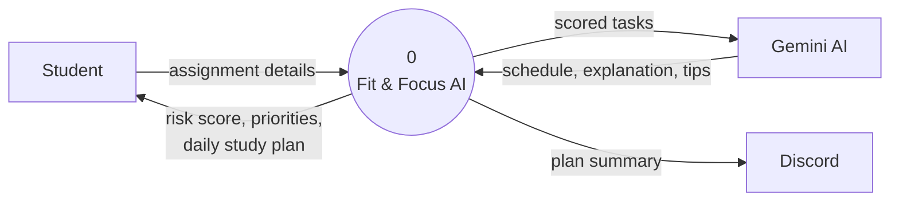
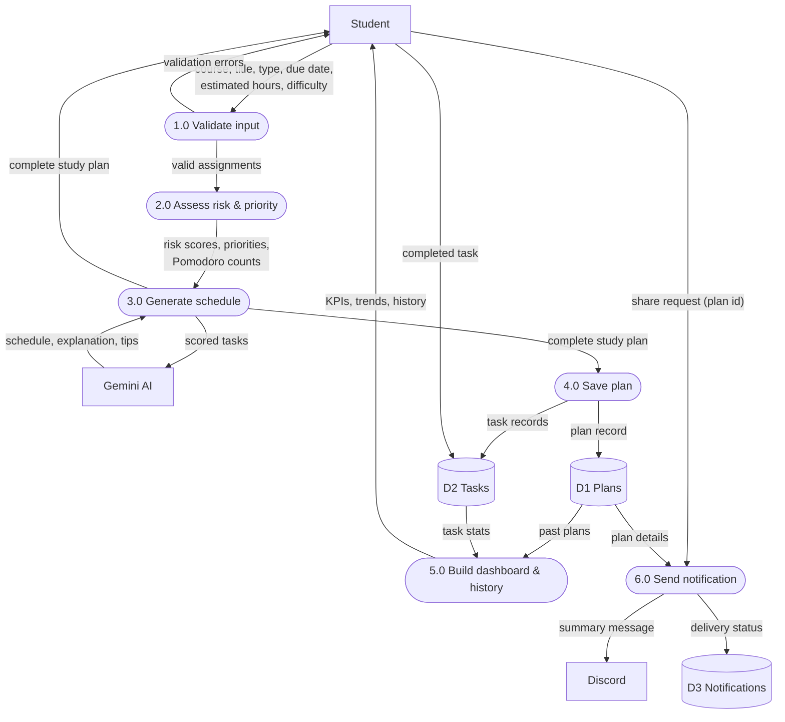
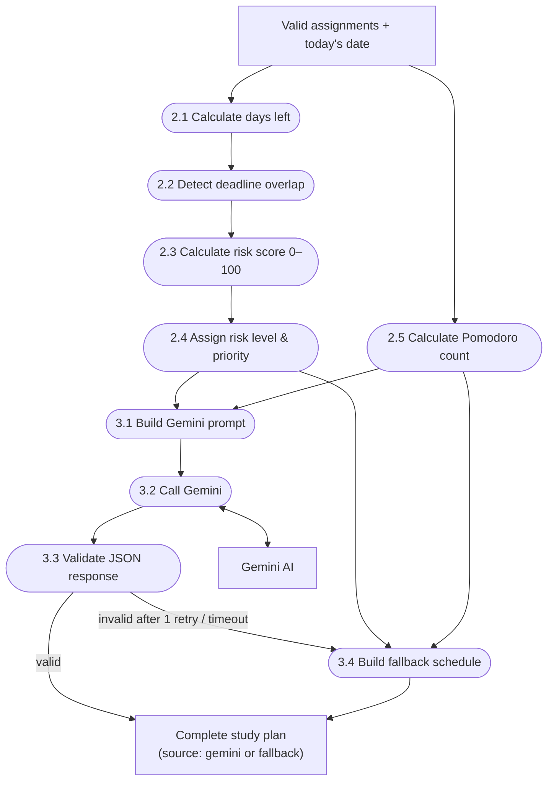
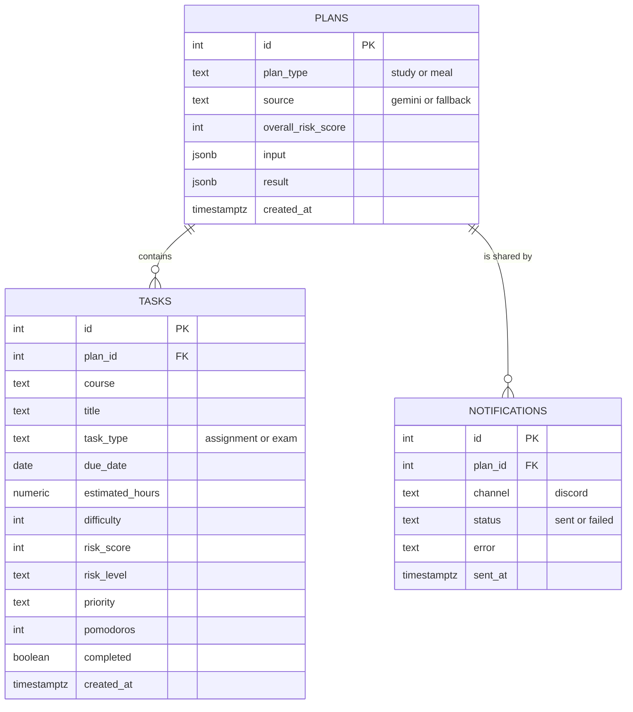

# Data Flow Diagram — Fit & Focus AI

| | |
|---|---|
| **Sprint** | Sprint 1 - Solution Design (1.3) |
| **Related** | [Architecture](architecture.md) · [Use Cases](use-cases.md) · [Sequence Diagrams](sequence-diagrams.md) |

This document shows **how data moves**, not which technology moves it.

**Notation:** rectangles = external entities · rounded = processes · cylinders = data stores.

---

## 1. Level 0 — Context Diagram

---

## 2. Level 1 — Main Processes

### Process summary

| Process | Input | Output |
|---------|-------|--------|
| 1.0 Validate input | Raw assignment details | Valid assignments or validation errors |
| 2.0 Assess risk & priority | Valid assignments, today's date | Risk score, risk level, priority, Pomodoro count per task |
| 3.0 Generate schedule | Scored tasks | Daily schedule, risk explanation, tips (from Gemini or fallback) |
| 4.0 Save plan | Complete study plan | Plan and task records |
| 5.0 Build dashboard & history | Stored plans and tasks | KPIs, trends, history list |
| 6.0 Send notification | Plan id | Discord message, delivery status |

---

## 3. Level 2 — Study Planner Engine (processes 2.0 and 3.0)

Formulas for 2.1 – 2.5 are defined in [architecture.md § 4](architecture.md#4-key-design-answers).

---

## 4. Data Entities

### Input data (from the student)

| Field | Type | Rules |
|-------|------|-------|
| `course` | text | Required, ≤ 50 characters |
| `title` | text | Required, ≤ 100 characters |
| `type` | `assignment` \| `exam` | Default `assignment` |
| `due_date` | date | Required, today or later |
| `estimated_hours` | number | 0.5 – 40 |
| `difficulty` | integer | 1 (easy) – 5 (hard) |

### Generated data (by the system)

| Field | Source |
|-------|--------|
| `risk_score`, `risk_level` | Planner engine |
| `priority`, `rank` | Planner engine |
| `pomodoros` | Planner engine |
| `daily_schedule` | Gemini (or fallback) |
| `risk_analysis`, `tips` | Gemini (or fallback text) |
| `source` | `gemini` or `fallback` |
| `warnings` | Planner engine (e.g. overload) |

### System data

| Field | Description |
|-------|-------------|
| `id` | Plan, task and notification identifiers |
| `created_at`, `sent_at` | Timestamps |
| `completed` | Task completion flag |
| Notification `status` | `sent` or `failed` |

---

## 5. ERD Preview (for Sprint 2)

Draft only; Sprint 2 finalizes the schema, data dictionary and `schema.sql`.

