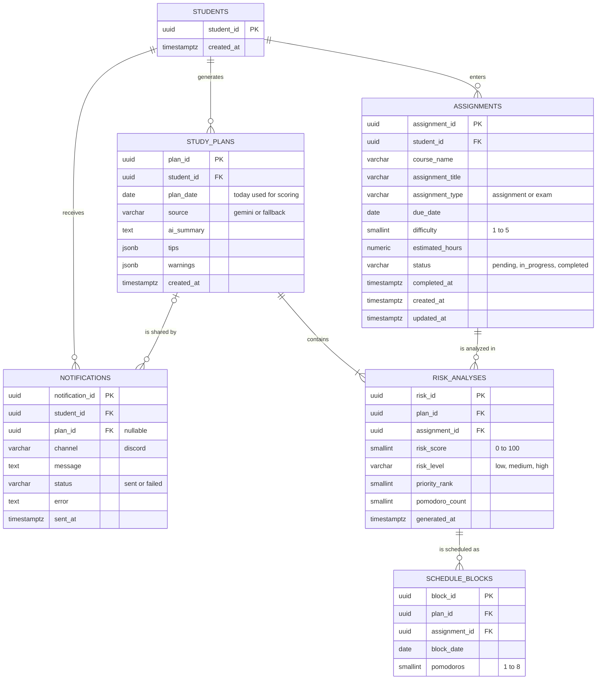

# ERD & Data Model Validation — Fit & Focus AI

| | |
|---|---|
| **Sprint** | Sprint 2 - Data Architecture (2.1, 2.3) |
| **Related** | [Data Dictionary](data-dictionary.md) · [Analytics Model](analytics-model.md) · [Architecture](architecture.md) · [Data Flow](data-flow.md) |

> **Sprint 2 goal:** even before the backend is written, a developer knows exactly what data is stored and how it is related.

---

## 1. Entities

| Entity (table) | One row per | Created by |
|----------------|-------------|------------|
| **Student** (`students`) | Anonymous browser user | Backend, on the first request with a new student ID |
| **Assignment** (`assignments`) | Assignment or exam entered by a student | Student (form) |
| **StudyPlan** (`study_plans`) | Click on **Generate Plan** | Planner engine + Gemini |
| **RiskAnalysis** (`risk_analyses`) | Assignment evaluated inside one plan | Planner engine |
| **ScheduleBlock** (`schedule_blocks`) | Pomodoros for one assignment on one day of a plan | Gemini (or fallback) |
| **Notification** (`notifications`) | Message sent to Discord | Discord service |

---

## 2. ERD



Simplified view:

```text
Student
 ├──< Assignment ──< RiskAnalysis >── StudyPlan
 │                        │
 │                        └──< ScheduleBlock
 ├──< StudyPlan
 └──< Notification >o── StudyPlan (optional)
```

---

## 3. Relationship Matrix

| Parent | Child | Type | Rule | On parent delete |
|--------|-------|------|------|------------------|
| Student | Assignment | 1 : N | A student enters many assignments | Cascade |
| Student | StudyPlan | 1 : N | A student generates many plans | Cascade |
| Student | Notification | 1 : N | A student receives many notifications | Cascade |
| StudyPlan | RiskAnalysis | 1 : N (at least 1) | A plan analyzes 1–20 assignments | Cascade |
| Assignment | RiskAnalysis | 1 : N | An assignment is re-analyzed each time a plan is regenerated (**history kept**) | Cascade |
| Assignment ↔ StudyPlan | — | **M : N** | Resolved by `risk_analyses` (one row per assignment per plan) | — |
| RiskAnalysis | ScheduleBlock | 1 : N | An assignment's Pomodoros in a plan are spread over several days | Cascade |
| StudyPlan | Notification | 1 : N (optional) | A plan can be shared many times; future reminders have no plan | Set null |

**Uniqueness rules**

| Table | Unique | Meaning |
|-------|--------|---------|
| `risk_analyses` | (`plan_id`, `assignment_id`) | An assignment appears once per plan |
| `risk_analyses` | (`plan_id`, `priority_rank`) | Ranks in a plan are 1, 2, 3… with no duplicates |
| `schedule_blocks` | (`plan_id`, `assignment_id`, `block_date`) | One block per assignment per day |

---

## 4. Data Model Validation

### Business questions

| # | Question | Answer | How the model supports it |
|---|----------|--------|---------------------------|
| 1 | Does a Student have many Assignments? | ✅ Yes | `assignments.student_id` (1 : N) |
| 2 | Does an Assignment have many RiskAnalyses? | ✅ Yes — **Option B, keep full history** | New `risk_analyses` row per plan; enables the Risk Trend chart |
| 3 | Does an Assignment have many StudyPlans? | ✅ Yes — regenerate creates v1, v2, v3 | M : N through `risk_analyses`; each regenerate creates a new `study_plans` row |
| 4 | Does a StudyPlan cover many Assignments? | ✅ Yes | The daily schedule mixes several assignments (Sprint 1 design) |
| 5 | Can a plan exist without assignments? | ❌ No | API requires 1–20 assignments; backend inserts plan and analyses in one transaction |

### Design decisions (approved)

| # | Decision | Reason |
|---|----------|--------|
| DM-1 | **Anonymous students.** `students` has only an ID and `created_at`; no name or email. The browser creates a UUID, stores it in `localStorage` and sends it with each request. | Keeps ADR-006 (no login, no personal data) while giving each user their own history (fixes review item Q-3). |
| DM-2 | **One StudyPlan per Generate Plan click**, covering all submitted assignments. | Matches the Sprint 1 daily schedule across assignments. |
| DM-3 | **Three risk levels:** low (0–39), medium (40–69), high (70–100). No CRITICAL. | Keeps the Sprint 1 formula and UI unchanged. |
| DM-4 | **Status:** `pending`, `in_progress`, `completed` stored; **overdue is calculated** (`status <> 'completed' AND due_date < today`). | A stored "overdue" would go stale without a background job. |
| DM-5 | **UUID primary keys** (`gen_random_uuid()`, built into PostgreSQL 13+). | IDs can't be guessed or counted; student IDs are created in the browser. |
| DM-6 | **Schedule blocks as a table** (option A). | The Study Time Trend chart can be queried with SQL. |
| DM-7 | **Regenerate reuses assignments.** When the student regenerates, the frontend sends the existing `assignment_id`s; the backend updates those rows and inserts new ones only for new assignments. | Keeps one assignment row with many analyses, so history and trends work. |
| DM-8 | **Fully relational, no JSONB copy of the whole plan.** Replaces ADR-005's `result` JSONB column. | Every field in the API response can be rebuilt from the tables. |

### Normalization (3NF) check

| Check | Result |
|-------|--------|
| **1NF** — atomic values, no repeating groups | ✅ Assignments and schedule days are separate rows. `tips` and `warnings` are display-only text lists stored as JSONB arrays and never queried individually. |
| **2NF** — no partial dependency on a composite key | ✅ Every table has a single-column UUID key. |
| **3NF** — no non-key column depends on another non-key column | ✅ with two documented exceptions below. |

**Values deliberately not stored (calculated instead):**

| Value | Calculated from |
|-------|-----------------|
| `priority` (High / Medium / Low) | Equals `risk_level` (Sprint 1 rule) |
| Overall plan risk score / level | `MAX(risk_score)` of the plan's `risk_analyses` |
| Total Pomodoros / tasks in a plan | `SUM` / `COUNT` of `risk_analyses` |
| Recommended hours | `pomodoro_count × 25 / 60` |
| Overdue | `status` and `due_date` |

**Documented exceptions:**

| Column | Why it is stored anyway | Guard |
|--------|-------------------------|-------|
| `risk_analyses.risk_level` | Depends on `risk_score`, but makes dashboard filters and grouping simple | `CHECK` constraint ensures it matches the score band |
| `notifications.student_id` | Could come from `plan_id`, but future reminders (UC-9) have no plan | `plan_id` is nullable |

**Snapshot rule:** `risk_score`, `risk_level`, `priority_rank` and `pomodoro_count` are a snapshot of the engine's result **at plan time**. If the student later edits an assignment's hours, old plans keep their original numbers. This is why they are stored and not recalculated.

### Not needed for the MVP

Data warehouse, event sourcing, CQRS, read replicas, partitioning. Expected volume is a few hundred to a few thousand rows.

### Rules enforced by the application (not the database)

| Rule | Where |
|------|-------|
| `due_date` is today or later when submitted | API validation (it may become past later, which is valid) |
| A day has at most 8 Pomodoros across all assignments | Gemini response validation / fallback engine |
| Schedule blocks fall on or before the due date | Gemini response validation |
| All assignments in a plan belong to the same student | Backend check before insert |
| Plan + analyses + blocks are saved together | One database transaction |
