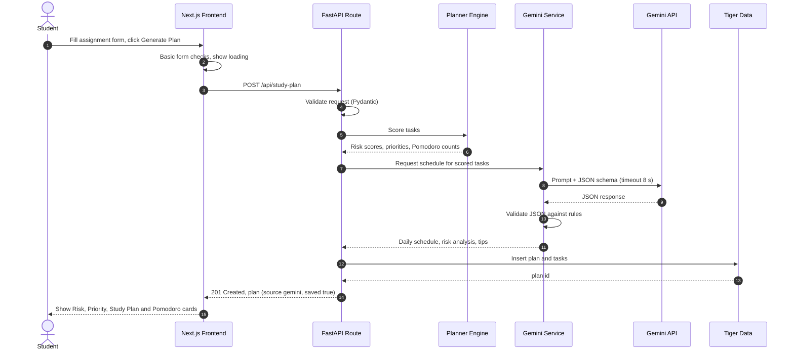
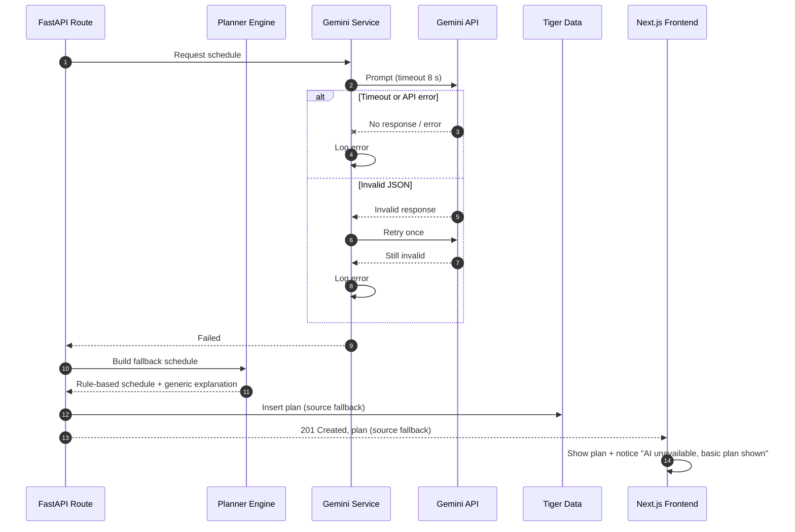
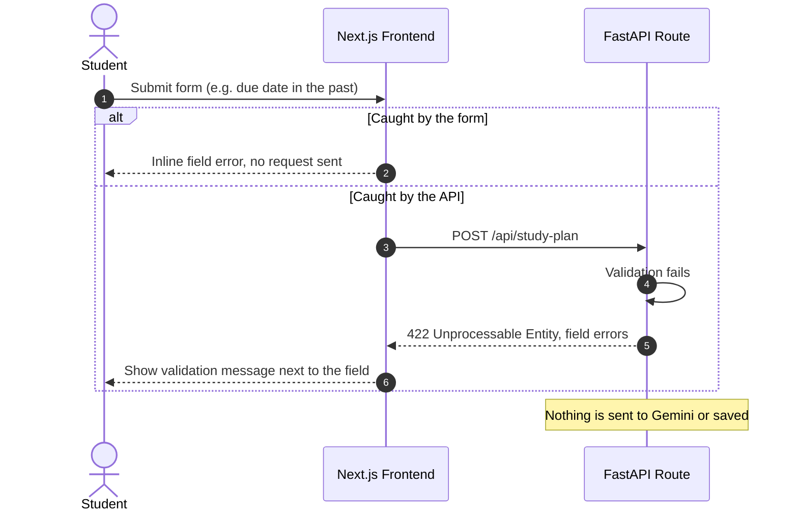
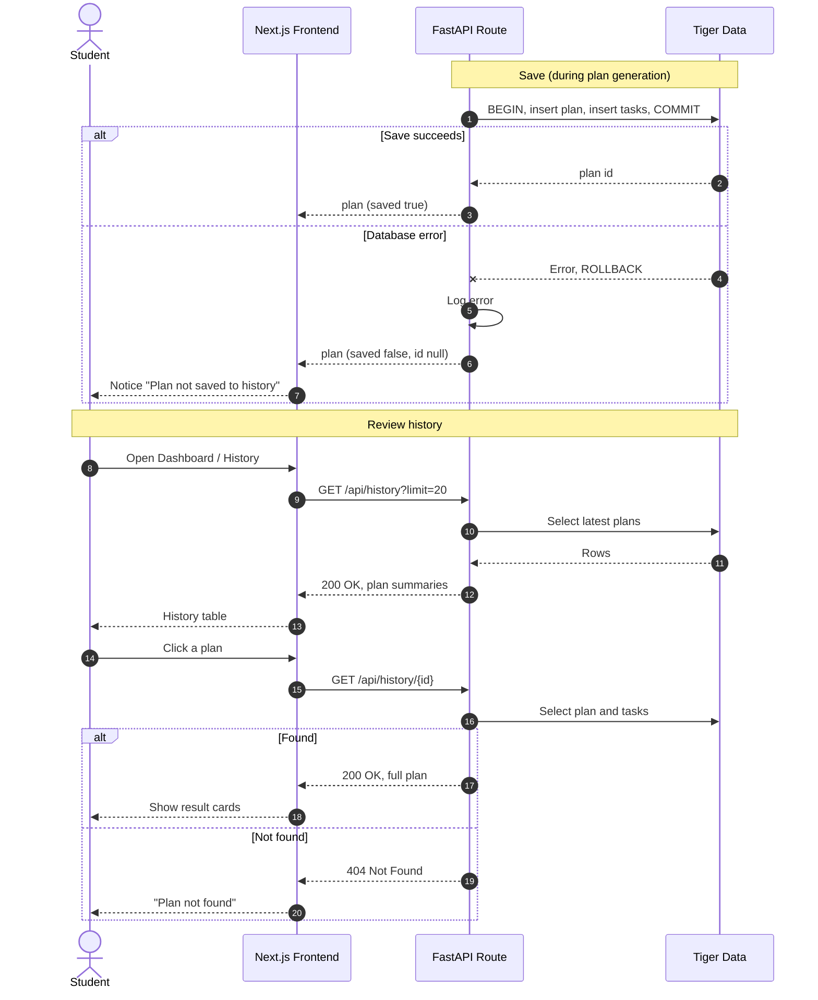
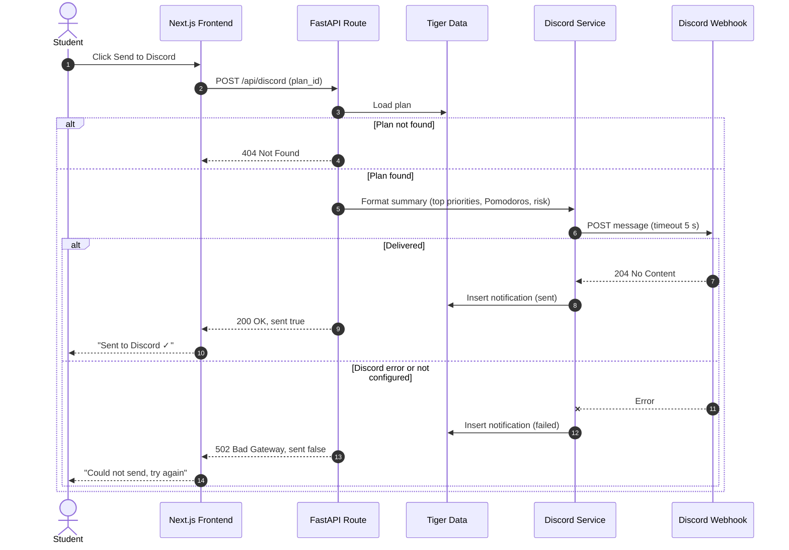

# Sequence Diagrams — Fit & Focus AI

| | |
|---|---|
| **Sprint** | Sprint 1 - Solution Design (1.4) |
| **Related** | [Architecture](architecture.md) · [API Design](api-design.md) · [Data Flow](data-flow.md) |

---

## Design Decisions

| Question | Decision |
|----------|----------|
| Synchronous or asynchronous? | **Synchronous.** `POST /api/study-plan` returns the finished plan in one request (ADR-004). |
| Timeout threshold | Gemini: **8 s** per call. Whole request target: **≤ 10 s**. |
| Retry strategy | **One retry** only when Gemini returns invalid JSON *and* time remains. No retry after a timeout. |
| Fallback behavior | Return the engine's rule-based schedule with `source: "fallback"` and a generic explanation. The frontend shows a notice. |
| Database failure | Still return the plan with `saved: false`; the frontend shows "not saved to history". |
| Logging | Log Gemini errors, fallbacks and failed saves (no API keys or personal data). |

---

## 1. Generate Study Plan (main scenario)

### Failure scenario A — Gemini timeout or invalid output

### Failure scenario B — Invalid input

---

## 2. Save and Review History

Saving happens inside *Generate Study Plan* (step 12 above). This diagram covers the save failure and reading history back.

---

## 3. Send Discord Notification

