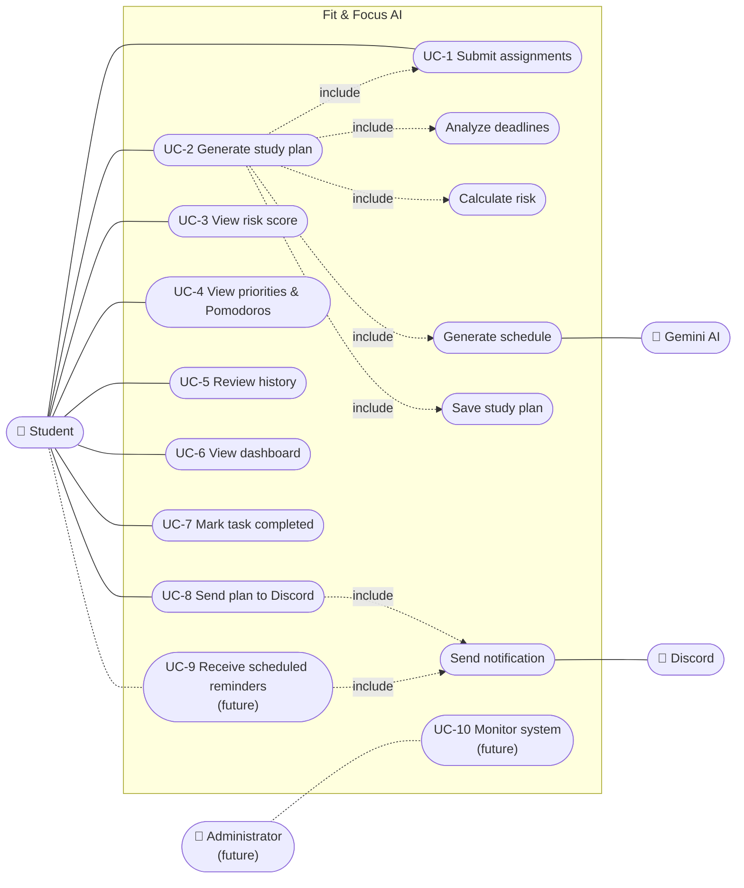

# Use Case Diagram — Fit & Focus AI

| | |
|---|---|
| **Sprint** | Sprint 1 - Solution Design (1.2) |
| **Related** | [Architecture](architecture.md) · [MVP Scope](mvp-scope.md) · [Sequence Diagrams](sequence-diagrams.md) |

This document answers **what users can do**, not how the system does it.

---

## 1. Actors

| Actor | Type | Description |
|-------|------|-------------|
| **Student** | Primary | Main user. Enters assignments and uses the plan. |
| **Gemini AI** | Secondary (system) | Generates the daily schedule, risk explanation and tips. |
| **Discord** | Secondary (system) | Receives plan summary messages. |
| **Administrator** | Secondary (future) | Monitors usage and system health. Not in the MVP. |

---

## 2. Use Case Diagram

> Solid lines = MVP. Dotted actor lines = future scope. `include` = always happens as part of the parent use case.

---

## 3. Use Case List

### Student use cases

| ID | Use case | Description | MVP | Priority |
|----|----------|-------------|-----|----------|
| UC-1 | Submit assignments | Enter course, title, type, due date, estimated hours and difficulty | ✅ | Must |
| UC-2 | Generate study plan | Get a daily plan from the submitted assignments | ✅ | Must |
| UC-3 | View risk score | See overall and per-task risk (0–100, Low / Medium / High) with an explanation | ✅ | Must |
| UC-4 | View priorities & Pomodoros | See ranked tasks and Pomodoro sessions per task | ✅ | Must |
| UC-5 | Review history | Open previously generated plans | ✅ | Should |
| UC-6 | View dashboard | See KPIs, risk trend and study time trend | ✅ | Should |
| UC-7 | Mark task completed | Tick a task as done so the dashboard counts it | ✅ | Should |
| UC-8 | Send plan to Discord | Share a plan summary to the Discord channel | ✅ | Should |
| UC-9 | Receive scheduled reminders | Automatic reminders before due dates | ⬜ | Future |

### System use cases

| ID | Use case | Triggered by | Description |
|----|----------|--------------|-------------|
| S-1 | Analyze deadlines | UC-2 | Days left and deadline overlap for each task |
| S-2 | Calculate risk | UC-2 | Rule-based risk score and priority |
| S-3 | Generate schedule | UC-2 | Gemini schedule, or fallback schedule from the engine |
| S-4 | Save study plan | UC-2 | Store plan and tasks in Tiger Data |
| S-5 | Send notification | UC-8 | Post summary to Discord webhook |

### Administrator use cases (future)

| ID | Use case | Description |
|----|----------|-------------|
| UC-10 | Monitor system | View usage, errors and Gemini fallback rate |

---

## 4. Main Use Case Detail — UC-2 Generate Study Plan

| Field | Description |
|-------|-------------|
| **Actor** | Student (primary), Gemini AI (secondary) |
| **Goal** | Get a prioritized daily study plan with risk analysis |
| **Precondition** | Student is on the Home page |
| **Trigger** | Student clicks **Generate Plan** |
| **Main flow** | 1. Student enters one or more assignments. 2. Student clicks Generate Plan. 3. System validates the input. 4. System calculates risk, priority and Pomodoros. 5. System asks Gemini for a schedule and explanation. 6. System saves the plan. 7. System shows Risk, Priority, Study Plan and Pomodoro cards. |
| **Alternative flow A** | Gemini fails or times out → system shows the fallback plan with a notice. |
| **Alternative flow B** | Input invalid (e.g. past due date, hours ≤ 0) → system shows a validation message; nothing is saved. |
| **Alternative flow C** | Database save fails → plan is still shown with a notice that it was not saved. |
| **Postcondition** | Plan is stored and appears in history and the dashboard. |

---

## 5. MVP Scope Check

| Use case | HackUTA MVP |
|----------|-------------|
| Generate plan | ✅ |
| Risk analysis | ✅ |
| Save history | ✅ |
| Dashboard | ✅ |
| Send to Discord | ✅ |
| Authentication | ⬜ Out of scope |
| Multiple users | ⬜ Out of scope |
| Mobile app | ⬜ Out of scope (responsive web instead) |
| Scheduled reminders | ⬜ Out of scope |
