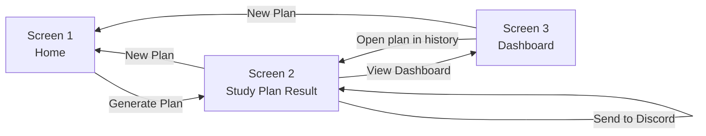

# UI Wireframes — Fit & Focus AI

| | |
|---|---|
| **Sprint** | Sprint 1 - Solution Design (1.5) |
| **Related** | [Use Cases](use-cases.md) · [API Design](api-design.md) |

Low-fidelity wireframes. They define **what is on each screen**, not the final look.

---

## Navigation



Top navigation on every screen: **Fit & Focus AI** (logo → Home) · **New Plan** · **Dashboard**.

---

## Screen 1 — Home Page

```text
┌──────────────────────────────────────────────────────────────┐
│  Fit & Focus AI                         [New Plan] [Dashboard]│
├──────────────────────────────────────────────────────────────┤
│                                                              │
│        Know what to study first.                             │
│        Enter your deadlines and get an AI study plan         │
│        with risk analysis in seconds.                        │
│                                                              │
├──────────────────────────────────────────────────────────────┤
│  Your assignments                                            │
│                                                              │
│  ┌── Assignment 1 ─────────────────────────────────── [✕] ┐  │
│  │ Course          [ COSC 1436              ]             │  │
│  │ Title           [ Programming Lab        ]             │  │
│  │ Type            (•) Assignment  ( ) Exam               │  │
│  │ Due date        [ 2026-11-20 📅 ]                      │  │
│  │ Estimated hours [ 6   ]                                │  │
│  │ Difficulty      ○ ○ ○ ● ○   (1 easy – 5 hard)          │  │
│  └────────────────────────────────────────────────────────┘  │
│                                                              │
│  [ + Add another assignment ]        [ Load sample data ]    │
│                                                              │
│               [ ✨ Generate Plan ]                            │
└──────────────────────────────────────────────────────────────┘
```

| Element | Behavior |
|---------|----------|
| Hero | Product name and one-line description |
| Assignment card | One per assignment; up to 20 |
| Inline validation | Required fields, due date not in the past, hours 0.5–40 |
| Load sample data | Fills 3–4 example assignments (for demos) |
| Generate Plan | Disabled until the form is valid; shows a spinner while loading |

---

## Screen 2 — Study Plan Result

```text
┌──────────────────────────────────────────────────────────────┐
│  Fit & Focus AI                         [New Plan] [Dashboard]│
├──────────────────────────────────────────────────────────────┤
│  ⚠ AI unavailable – basic plan shown   (only if fallback)    │
│                                                              │
│  ┌─ Risk ───────────────┐   ┌─ Priority ──────────────────┐  │
│  │  HIGH RISK           │   │ 1. Programming Lab   HIGH 78│  │
│  │     78 / 100         │   │ 2. Networking Quiz   MED  52│  │
│  │  ████████████░░░     │   │ 3. English Essay     LOW  21│  │
│  │  Lab is due in 2 days│   └─────────────────────────────┘  │
│  │  and needs 6 hours...│                                    │
│  └──────────────────────┘                                    │
│                                                              │
│  ┌─ Study Plan ────────────────────────────────────────────┐ │
│  │ Mon 11/16   🍅🍅🍅 Programming Lab   🍅 Networking Quiz  │ │
│  │ Tue 11/17   🍅🍅🍅 Programming Lab   🍅🍅 Networking     │ │
│  │ Wed 11/18   🍅🍅 Programming Lab     🍅 English Essay    │ │
│  │ ...                                                     │ │
│  └─────────────────────────────────────────────────────────┘ │
│                                                              │
│  ┌─ Pomodoros ──────────────────┐  ┌─ Tips ───────────────┐  │
│  │ Programming Lab   15  [ ] done│  │ • Start the lab today│  │
│  │ Networking Quiz    5  [ ] done│  │ • Review notes in    │  │
│  │ English Essay      4  [ ] done│  │   short sessions     │  │
│  │ 1 🍅 = 25 min + 5 min break   │  └──────────────────────┘  │
│  └──────────────────────────────┘                            │
│                                                              │
│  [ 💬 Send to Discord ]   [ View Dashboard ]   [ New Plan ]  │
└──────────────────────────────────────────────────────────────┘
```

| Card | Data (from API) |
|------|-----------------|
| Risk | `summary.overall_risk_score`, `summary.overall_risk_level`, `risk_analysis` |
| Priority | `tasks[]` sorted by `rank` with `priority` and `risk_score` |
| Study Plan | `daily_schedule[]` |
| Pomodoros | `tasks[].pomodoros`, done checkbox → `status` (`PATCH /api/assignments/{id}`) |
| Tips | `tips[]` |
| Notices | `source = fallback`, `saved = false`, `warnings[]` |

---

## Screen 3 — Dashboard

```text
┌──────────────────────────────────────────────────────────────┐
│  Fit & Focus AI                         [New Plan] [Dashboard]│
├──────────────────────────────────────────────────────────────┤
│  ┌─ Total ──────┐ ┌─ Avg risk ───┐ ┌─ Completed ─┐ ┌─ Plans ─┐ │
│  │ 12 tasks     │ │ 54 / 100     │ │ 5 / 12      │ │ 4       │ │
│  └──────────────┘ └──────────────┘ └─────────────┘ └─────────┘ │
│                                                              │
│  ┌─ Risk trend ────────────────┐ ┌─ Study time trend ───────┐│
│  │ 100┤        ╭╮              │ │ 🍅 ┤ ▇                    ││
│  │  50┤ ╭─────╯ ╰──╮           │ │    ┤ ▇ ▇   ▇              ││
│  │   0┼────────────────        │ │    ┼─▇─▇─▇─▇──            ││
│  │     11/10  11/13  11/16     │ │     M T W T F             ││
│  └─────────────────────────────┘ └──────────────────────────┘│
│                                                              │
│  History                                                     │
│  ┌──────────┬───────┬──────────┬────────┬──────────┐         │
│  │ Date     │ Tasks │ Risk     │ Source │          │         │
│  ├──────────┼───────┼──────────┼────────┼──────────┤         │
│  │ 11/16    │ 3     │ 78 HIGH  │ Gemini │ [Open]   │         │
│  │ 11/14    │ 2     │ 45 MED   │ Gemini │ [Open]   │         │
│  └──────────┴───────┴──────────┴────────┴──────────┘         │
└──────────────────────────────────────────────────────────────┘
```

| Element | Data (from API) |
|---------|-----------------|
| Total tasks | `GET /api/dashboard` → `total_tasks` |
| Average risk score | `average_risk_score` |
| Completed tasks | `completed_tasks` / `total_tasks` |
| Plans generated | `total_plans` |
| Risk trend | `risk_trend[]` — average task risk per day plans were created |
| Study time trend | `study_time_trend[]` — scheduled Pomodoros per day |
| History table | `GET /api/history` |

---

## Mobile Layout

Under 768 px wide, cards stack in one column in this order: notices → Risk → Priority → Study Plan → Pomodoros → Tips → buttons. Dashboard KPI tiles become a 2 × 2 grid; charts scroll horizontally if needed.

---

## UX Validation Checklist

| Check | Target | How the design meets it |
|-------|--------|-------------------------|
| Plan generated in under 60 seconds | ✅ | One form, one button; ~10 s response; sample data button |
| Fewer than 5 clicks | ✅ | Fill form → Generate Plan (1 click) → results |
| Dashboard understandable without training | ✅ | 4 labeled numbers, 2 charts, 1 table |
| Mobile view supported | ✅ | Single-column stacked layout |
| Errors are clear | ✅ | Inline field errors and notice banners |
